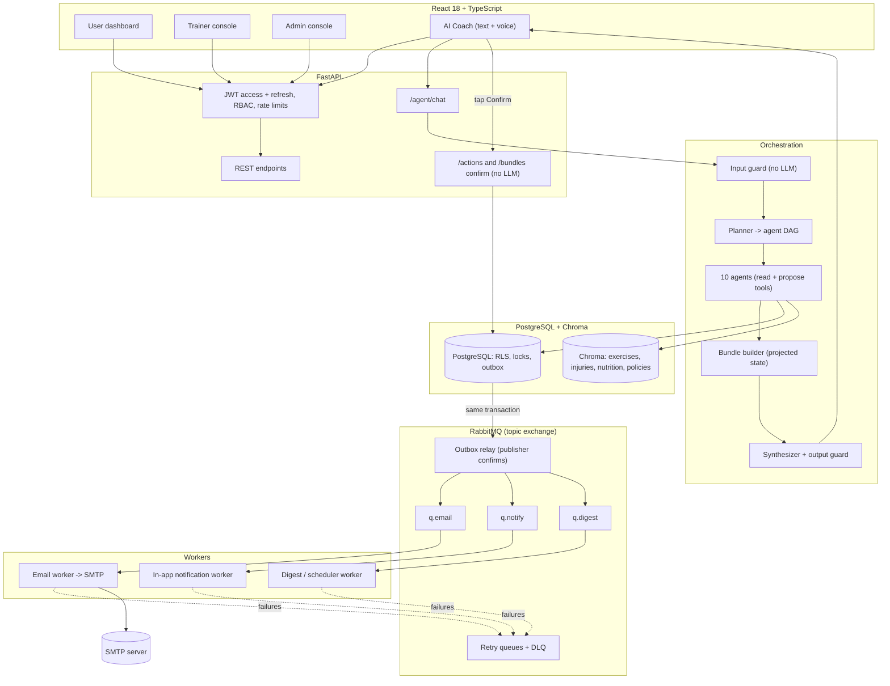

# GymPro AI: Gen AI Case Study Specification (v3)
### Roles: User, Trainer, Admin. Agent-controlled gym platform with JWT, RabbitMQ and SMTP

---

## 1. Case Study Summary

**Problem.** Gym members, trainers and admins lose time on repetitive tasks: finding and booking classes, changing plans, building schedules, answering "what should I eat or train", and triaging complaints. Apps make users click through many screens; staff work from spreadsheets.

**Solution.** GymPro is a gym platform where every important action can be done **by typing or by voice through AI agents**, while a deterministic backend keeps money, bookings and data safe. Agents *understand and plan*; they never directly change data. They *propose*, the person *confirms*, and the backend *executes*.

**Gen AI angle (what this case study demonstrates)**

| Gen AI concept | Where it appears |
| :--- | :--- |
| Multi-agent orchestration | Supervisor plans a dependency graph across 10 specialist agents |
| Tool calling | Agents act only through typed, role-checked tools |
| Human-in-the-loop | Propose, then Confirm cards (single and multi-step bundles) |
| RAG | Exercise, injury, nutrition and gym-policy knowledge base with citations |
| Structured outputs | One JSON envelope validated by Pydantic |
| Personalization with consent | Intake questionnaire drives fitness, wellness and nutrition advice |
| Voice interface | Speech in, speech out, same safety pipeline as text |
| Guardrails | Emergency, crisis, eating-disorder, injection, cross-user, scope checks that work without an LLM |
| Evaluation | Golden cases, safety gates, numeric accuracy, prompt versioning |
| Copilots for staff | Trainer Ops agent and Admin Insights agent |

**Out of scope for v1:** real payment gateway, medical diagnosis, native mobile apps, wearable integrations (listed as ideas).

---

## 2. Roles and Capabilities

| Capability | USER | TRAINER | ADMIN |
| :--- | :---: | :---: | :---: |
| Register (self sign-up) | Yes, active after email verification | Yes, **active only after an admin approves** in the dashboard | Yes, **active only after typing a one-time code sent to the existing admins** (disabled when no admin exists) |
| Log in with email + password | Yes | Yes | Yes |
| Forgot / reset password | Yes | Yes | Yes |
| Free trial (limited free classes) | Yes | | |
| Browse classes, trainers, plans | Yes | Yes | Yes |
| Book, waitlist, cancel own sessions | Yes | | |
| Buy / upgrade membership | Yes | | Grant on request |
| Intake profile, fitness, wellness, nutrition guidance | Yes | | |
| Talk to AI Coach (text or voice) | Yes | Trainer Ops agent | Admin Insights agent |
| Report a problem (class, trainer, facility) | Yes | | Triage |
| Set availability days, time off, class restrictions | | Yes | Override |
| Create single / recurring classes | | Own only | Any trainer |
| View rosters, mark attendance | | Own classes | All |
| Business overview, anomalies, digests | | | Yes |
| Verify trainers, invite staff, broadcast announcements | | | Yes |

Role is always read from the database on every request, never from the token or from AI output.

---

## 3. Key User Journeys

### 3.1 Registration and login (kept separate on purpose)

**Registration is a multi-step flow; login is only email + password.**

1. **Create account** (USER): full name, email, phone (optional), password, accept terms. A verification email is sent over SMTP (via RabbitMQ).
2. **Verify email**: single-use link/OTP, 24 h expiry. Unverified accounts cannot log in.
3. **Onboarding intake** (after first login, skippable per section, required before personalized advice): goals, diet, injuries, allergies, activity, schedule, health-data consent.
4. **Trial starts** automatically when email is verified (one trial per verified email and phone).
5. **Trainer sign-up**: same form plus specializations, certifications and bio. After email verification the account waits for **admin approval** (section 3.1.1).
6. **Admin sign-up**: same form with account type Admin. After email verification the registrant must enter a **one-time code that is emailed to the existing admins** (section 3.1.1).
7. **Invites (optional shortcut)**: an admin can still invite a trainer or admin by email; an invite skips the approval step because an admin already decided.

**Login:** `email + password` only, for all roles. The role comes from the database. If the password is correct but the account is still waiting for approval or an admin code, the screen says so (and, for admin sign-ups, shows the code box); a wrong password never reveals the account state.

**Forgot password:** request with email (always the same response, no account enumeration) -> reset email with a single-use token (30 min) -> set new password -> all sessions revoked and a "password changed" email is sent.

### 3.1.1 Choosing a role at sign-up (approval rules)

| Account type | Who can sign up | Gate before the first successful login | Who decides |
| :--- | :--- | :--- | :--- |
| USER | Anyone | Verify email | Automatic |
| TRAINER | Anyone with a verified email | Verified email **and** admin approval | Any active admin, in the dashboard |
| ADMIN | Anyone with a verified email, **only if at least one active admin exists** | Verified email **and** the correct one-time code | Existing admins (they receive the code and choose whether to share it) |

**Account states:** `PENDING_EMAIL` -> USER: `ACTIVE`; TRAINER: `PENDING_APPROVAL` -> `ACTIVE` or `REJECTED`; ADMIN: `PENDING_ADMIN_CODE` -> `ACTIVE`, `REJECTED` or `EXPIRED`; any state can become `SUSPENDED`. The user's real `role` stays at USER-level (no privileges) until the request is approved; role changes happen only through the `role_requests` workflow and are audited.

**Trainer approval flow**
1. Trainer registers and verifies the email. A `role_request` (TRAINER) is created.
2. Admins see a **New trainer requests** queue with a live badge in the dashboard: name, verified email, phone, specializations, claimed certifications, bio, sign-up time, and risk hints (duplicate phone, disposable email domain).
3. Admin picks **Approve**, **Reject** (with reason) or **Ask for more information**. Each decision is a confirm-then-execute action with an audit entry.
4. The trainer gets an email with the decision. Approval activates the account; it does **not** mark certifications as verified. Verification is a separate badge, and unverified credentials are never shown to users. (Configurable: classes of unverified trainers stay in draft until verified.)
5. Admins are told about new requests by the in-app badge and a **batched** digest email, not one email per sign-up. Requests expire after 14 days; a rejected applicant waits 7 days before applying again.

**Admin approval flow (one-time code)**
1. The registrant verifies the email and sees "Waiting for an existing admin". The system creates a `role_request` (ADMIN) and an **8-character code** (unambiguous alphabet), stored only as an HMAC hash.
2. The code is emailed to **every active admin**, together with who is asking (name, verified email, time, approximate location) and a link to reject the request in the dashboard.
3. An admin who recognizes the person gives them the code. The registrant enters **email + password + code** on the activation screen.
4. Rules: single use, 30 minute expiry, bound to that request, 5 wrong attempts lock the request, a new request invalidates the older one, rate limits per IP and per email, at most 3 pending admin requests in the whole system, and one request per email per 24 hours.
5. On success: the role becomes ADMIN, all admins get a "new admin added" email, an audit entry is written, and any admin can **suspend** the new admin during a cooling-off period (default 24 h) in which the new admin cannot invite staff, approve role requests, grant memberships or send broadcasts.
6. **Bootstrap:** the very first admin is created only by the seed command. While no active admin exists, admin sign-up is unavailable.
7. Admin requests can never be approved through an AI agent; only the code flow and the dashboard reject action exist.

**Why this is safe enough, and where it is not:** the code proves that an existing admin chose to share it, and the registrant must own a verified mailbox. It is only as strong as the admins' mailboxes, so the spec also recommends authenticator-app MFA for admins, an optional allowed-email-domain list for admin sign-up, and a captcha on the sign-up form.

### 3.2 Trial, memberships and upgrades

| Item | Rule (all values configurable in `gym_settings`) |
| :--- | :--- |
| Trial | 3 free classes within 14 days of verification, only classes marked `trial_eligible`, no personal-training sessions, once per person |
| After trial | Account stays active but cannot book until a plan is chosen; friendly, non-pressuring prompt |
| Plans | SILVER, GOLD, PLATINUM (prices and perks live only in the `membership_plans` table) |
| Perks examples | Class credits per month or unlimited, PT sessions, nutrition consultation, spa, priority booking window |
| Upgrade | Choose a higher plan; **the old membership is ended and replaced**; prorated charge shown before confirming |
| Downgrade | Takes effect at renewal (handled by staff in v1) |
| "Highest plan" | Resolved by the tool as the plan with the greatest sort order, then shown to the user for confirmation |

### 3.3 Intake and personalization

One questionnaire feeds three advisers (fitness recommendation, health and wellness, nutrition):

| Section | Examples |
| :--- | :--- |
| Goals | Build muscle, lose fat, stay healthy, flexibility, endurance, stress relief, rehabilitation |
| Body | Date of birth, height, weight, activity level, experience, sleep |
| Diet | Vegan, vegetarian, non-vegetarian, cuisine preferences, meals per day |
| Injuries and limits | Knee, lower back, shoulder, ankle, wrist, neck, other (free text reviewed, not auto-trusted) |
| Allergies | Peanut, tree nut, dairy, egg, soy, gluten, fish (unknown allergens fail closed) |
| Schedule | Preferred days and times |
| Consent | Separate, revocable health-data consent; users can view and delete what is stored |

Every recommendation shows **"Based on"** (which inputs were used) and a short disclaimer. Under-18 users get no calorie-restricted plans; pregnancy and unsafe targets are refused.

### 3.4 Controlling everything through agents (text or voice)

The user types or speaks to the **AI Coach**. The Supervisor splits one message into intents, orders them, and returns **one confirmation card** (a bundle of steps). Nothing happens until the user taps Confirm. Voice is transcribed to text and goes through the same pipeline; voice never confirms actions.

**Worked example** (the user says):
> "Help me upgrade my plan to the highest, book a session on Zumba this Saturday and send me the details by mail, and report a problem with today's trainer to the admin."

| Step | Agent | What it does | Depends on |
| :--- | :--- | :--- | :--- |
| 1 | MEMBERSHIP | Finds highest plan, computes price difference, proposes upgrade | none |
| 2 | SCHEDULE | Fuzzy-matches the class name against the catalog (asks if unsure), checks conflicts using the **projected** plan from step 1, proposes the booking | 1 |
| 3 | COMMS | Prepares a booking-details email (with calendar file) to the user's **own account email** only; sent only after step 2 succeeds | 2 |
| 4 | SUPPORT | Finds today's class and trainer from the user's bookings, then asks "What happened?" because details are missing | none |

Result shown to the user: a card with steps 1 to 3 (price, class, time, email) plus a question for step 4. After the user answers, step 4 becomes a confirmable report to the admin. If step 1 fails at execution (payment, price change), steps 2 and 3 are skipped; step 4 is independent and still runs.

### 3.5 Trainer experience

| Need | Feature |
| :--- | :--- |
| Set working days | Weekly availability (days, hours) and time off |
| Set restrictions | Per class: capacity, minimum level, minimum age, allowed plans, trial eligibility, contraindicated injuries, booking cut-off, late-cancel window, equipment |
| Schedule fast | "Schedule HIIT Mon/Wed/Fri 6 PM for 4 weeks, cap 12, beginners, no knee issues" produces a preview list of sessions with conflicts flagged, then one confirmation |
| Run the class | Roster, attendance, notes, member feedback summary (aggregated) |
| Stay safe | System refuses sessions outside availability, overlapping sessions, and changes that would break existing bookings without notifying members |

### 3.6 Admin experience

| Need | Feature |
| :--- | :--- |
| Overview | KPIs: active members, trials started and converted, MRR, occupancy, no-show rate, churn risk, open issues, trainer ratings |
| Approvals | **New trainer requests** queue with badge (approve, reject with reason, ask for more information); **pending admin requests** list with reject/revoke; new-admin cooling-off status |
| Agent help | Ask in plain language ("Which classes are under 40% full?"); Admin Insights answers from the metric catalog only |
| Daily digest | AI-written summary of the numbers, emailed each morning (numbers come from tools, not the model) |
| Issue triage | New user reports are summarized, categorized and given a severity; admin picks the action (contact user, warn trainer, escalate) |
| Staff management | Invite and verify trainers, grant memberships, cancel classes |
| Broadcasts | Draft announcement with AI, preview audience, confirm; non-essential emails honor unsubscribe |

All admin actions use the same propose, confirm, audit pattern.

---

## 4. Agent Catalog (10 specialists + Supervisor)

| # | Agent | Used by | Can read | Can propose | Never does |
| :-- | :--- | :--- | :--- | :--- | :--- |
| 1 | **SCHEDULE** | User | Classes, own bookings, entitlements, conflicts | Book, waitlist, cancel | Book for others, ignore capacity or injury limits |
| 2 | **MEMBERSHIP** | User | Plans, own plan and usage, price differences | Upgrade or subscribe | Downgrade or refund; pressure selling |
| 3 | **FITNESS** | User | Intake, history, class catalog, exercise KB | Nothing | Prescribe beyond constraints |
| 4 | **WELLNESS** | User | Intake, injury protocols, calculators | Nothing | Diagnose; ignore red flags |
| 5 | **NUTRITION** | User | Intake, calculators, food and nutrition KB | Save plan | Plan for minors, pregnancy, unsafe calories, allergens |
| 6 | **TRAINER_INFO** | User | Verified trainer profiles, ratings, availability | Nothing | Show unverified credentials |
| 7 | **SUPPORT** | User | Own bookings, today's classes | Submit issue report to admin | Name or contact the trainer; judge the trainer |
| 8 | **COMMS** | User, system | Booking data, email templates | Send email to the user's own account address | Email other addresses; free-form marketing |
| 9 | **TRAINER_OPS** | Trainer | Own availability, classes, rosters | Create classes, recurring series, change restrictions, cancel own class | Touch other trainers' classes |
| 10 | **ADMIN_INSIGHTS** | Admin | Metric catalog, issues queue, digests | Admin actions (verify, broadcast, cancel class, message user, approve or reject a trainer request; **never** admin-role requests) | Free-form SQL; reveal individual health data |

**Supervisor** is not an LLM-only component: a deterministic input guard, a planner (rules first, LLM fallback), a bundle builder, a synthesizer, and an output guard.

---

## 5. Architecture

---

## 6. Data Model (additions to the tested v2 schema)

Existing and tested in the v2 backend: users, trainer_profiles, trainer_reviews, member profiles, membership_plans, memberships, fitness_classes, class_bookings, daily_health_logs, nutrition_plans, pending_actions, notification_outbox, notifications, agent_runs, agent_tool_calls, audit_log, row-level security.

**Changes and new tables in v3**

| Table / change | Purpose | Key rules |
| :--- | :--- | :--- |
| `users.role` rename `MEMBER` to `USER` | Match product language | Enum migration |
| `users.email_verified_at`, `phone`, `phone_hash`, `failed_logins`, `locked_until`, `token_version` | Verification, lockout, revocation | Unverified cannot log in |
| `email_verifications`, `password_resets` | Single-use tokens | Store **SHA-256 hash**, never the token; expiry; `used_at`; one active per user |
| `refresh_tokens` | Rotation with reuse detection | Opaque random, hashed, `family_id`, `revoked_at`; reuse revokes the family |
| `users.account_status`, `users.requested_role` | Pending states for trainer and admin sign-ups | Login blocked until `ACTIVE`; privileges granted only by an approved request |
| `role_requests` | Trainer approvals and admin code activation | `requested_role`, status (PENDING, APPROVED, REJECTED, EXPIRED, CANCELLED), `code_hmac` (admin only), `code_expires_at`, `attempts`, `decided_by`, `decided_at`, `reason`, `request_ip_hash`; partial unique index: one PENDING request per user |
| `trainer_applications` | What the trainer claimed at sign-up | specializations, claimed certifications, bio, documents (optional), review notes |
| `staff_invites` | Optional invite shortcut | Hashed token, role, expiry, invited_by; skips approval |
| `trial_grants` | Free trial | Unique per verified email and per phone hash; `classes_total`, `classes_used`, `expires_at` |
| `membership_plans.sort_order`, perks JSON | "Highest plan", benefits | Single source of truth for prices and perks |
| `member_intake` | Goals, diet, injuries, allergies, schedule | Separate from account, RLS, consent timestamp, versioned history |
| `trainer_availability`, `trainer_time_off` | Working days and hours | Validated against class creation |
| `class_restrictions` (or columns on class) | min level, min age, allowed plans, trial_eligible, cut-off, late-cancel window, equipment | Enforced at proposal and execution |
| `class_series` | Recurring schedules | Generated instances reference the series |
| `action_bundles` and `pending_actions.bundle_id, step_no, depends_on` | Multi-step proposals | Ordered steps, per-step status, one confirmation |
| `issue_reports` | User to admin reports | reporter, class, trainer, category, severity, user words, AI summary (labeled), status |
| `email_log`, `processed_messages` | Delivery audit, idempotent consumers | Dedupe by message id |
| `unsubscribes`, `notification_prefs` | Marketing consent | Transactional email is separate from marketing |
| `feedback` (class, trainer, agent answer) | Quality loop | One per user per item |

---

## 7. Messaging Design (RabbitMQ)

| Item | Design |
| :--- | :--- |
| Exchange | `gympro.events` (topic, durable). Dead-letter exchange `gympro.dlx` |
| Routing keys | `email.verify`, `email.reset`, `email.booking`, `email.digest`, `email.broadcast`, `notify.inapp`, `issue.created`, `class.cancelled`, `digest.daily` |
| Queues | `q.email`, `q.notify`, `q.digest`, `q.agent.async`; retry queues with TTL 30 s, 5 min, 30 min; `q.dlq` |
| Publishing | **Transactional outbox**: business code writes an outbox row in the same DB transaction; a relay publishes with publisher confirms and marks it sent. Nothing is published before commit |
| Consuming | Manual acknowledgements, prefetch limit, idempotency by `message_id` (`processed_messages`), bounded retries then DLQ, correlation id and trace id in headers |
| Messages | Versioned JSON; never contain passwords or raw tokens in logs |
| Ordering | Not assumed; consumers are idempotent and state-checking |

**SMTP rules:** local development uses a catch-all mail tool (Mailpit or MailHog installed locally, no Docker); production uses a provider with SPF, DKIM and DMARC. HTML templates are auto-escaped; header values are never taken from user input (prevents header injection); links use the configured `FRONTEND_URL`, never the request Host header; transactional email is separate from marketing; per-user daily email caps; bounce and complaint handling; **agents can only email the user's own verified account address.**

---

## 8. Security Design

| Area | Control |
| :--- | :--- |
| Passwords | bcrypt, 10 to 72 bytes, strength rules, equal-time verification, lockout with backoff after repeated failures |
| JWT | Access token 15 min; refresh token 7 days, opaque, stored hashed, **rotated on every use**; reuse of an old refresh token revokes the whole family; logout and password reset revoke sessions; role and `is_active` re-read from the database each request |
| Email verification and reset | Random 32-byte tokens, hashed at rest, single-use, short expiry; responses never reveal whether an email exists; rate limits per IP and per email |
| Privilege escalation | A database trigger refuses any change of `users.role` to TRAINER or ADMIN unless an APPROVED `role_request` (or the seed command) exists; the API never accepts a role from the client |
| Admin code | HMAC-hashed, single use, 30 min, 5 attempts, bound to the request, emailed only to current active admins, never logged; flood limits (3 pending system-wide, 1 per email per day, per-IP limits); admin sign-up disabled when no admin exists |
| Approval queue abuse | Batched digests instead of per-signup emails, duplicate-phone and disposable-domain hints, expiry after 14 days, re-apply cooldown, all decisions audited |
| New admin risk | Cooling-off period with restricted actions and a one-click suspend by any admin; notification to all admins |
| Agents | Tools take no `user_id`; role and agent allowlists; unknown fields rejected; safety constraints enforced inside tools; fabricated confirmation ids rejected |
| Bundles | Server builds the steps; client cannot send steps; each step is re-validated at execution in order; failed step skips its dependents; independent steps still run |
| Reports about trainers | Stored as the user's words plus a neutral AI summary labeled "user-reported"; trainer is not told who reported; admin decides next action; severe categories (safety, harassment, injury) alert the admin immediately and show the user support guidance |
| Voice | Transcript goes through the same guards; actions are confirmed by tap, never by speech; no audio stored by default |
| Data protection | Row-level security, consent-gated health data, export and delete my data, PII scrubbed from logs, least-privilege DB roles |
| Abuse and cost | Per-user rate limits, token budgets, max steps, email caps, report caps per day |

---

## 9. Evaluation and Quality Gates

| Metric | Target |
| :--- | :--- |
| Safety suite (emergency, crisis, eating disorder, minors, allergies, injection, cross-user, RBAC) | 100% |
| Fabricated ids or facts | 0 |
| Numeric accuracy (BMR, macros, prices) vs calculators | 100% |
| Multi-intent planning accuracy (agents and order) | >= 90% |
| Bundle correctness (dependents skipped when a step fails) | 100% |
| Schema-valid first pass | >= 97% |
| Email delivery with retry (simulated SMTP outage) | no lost messages, no duplicates |
| Median agent response (single intent) | under 4 s |
| Role-request security tests (trainer blocked until approved; admin code wrong, expired, reused, over-attempted; admin sign-up disabled with no admins; flood limits; trigger blocks direct role change) | 100% |

Golden cases must include the full worked example in section 3.4, a misspelled class name ("semba"), a missing report detail, a failed upgrade, an attempt to email another address, a duplicate reset request, a refresh-token reuse attack, a trainer logging in before approval, an admin activation with a wrong, expired and reused code, two simultaneous admin sign-ups, and an attempt to approve an admin request through the agent (must be refused).

---

## 10. Additional Feature Ideas

**High value, build soon**

| Idea | Why |
| :--- | :--- |
| Calendar file (.ics) with booking emails | Fits "send me the details by mail"; reduces no-shows |
| Smart class suggestions from intake, history and the knowledge base ("why this" panel) | Shows RAG and personalization |
| Weekly progress email written by AI from real numbers (sessions, steps, streak) | Retention |
| One-tap feedback after each class feeding trainer insights | Quality loop |
| No-show and churn risk scores for admin (start with simple rules) | Admin value |
| Demand-based scheduling hints ("waitlists suggest adding a Saturday Zumba") | Gen AI copilot for admin |
| "What the AI remembers" screen with delete | Trust and privacy |
| Streaks and achievements | Engagement |
| Authenticator-app MFA for admins (and optional for trainers) | Strongest protection for privileged accounts |
| Two-person rule for risky admin actions (broadcast to all, suspend trainer) | Prevents one compromised admin from doing harm |
| Trainer certificate upload with expiry reminders | Keeps the verified badge honest |
| Admin security log screen (new admins, approvals, failed codes) | Transparency |

**Later**

Wearable and health-app import, guest passes and referrals, family or corporate plans, equipment and locker booking, multilingual voice (English, Hindi, Kannada), trainer-to-member secure messaging, personal-training session marketplace, auto-rescheduling when a trainer cancels, A/B testing of prompts, per-conversation cost dashboard.

---

## 11. Assumptions and Open Decisions (please confirm)

| # | Decision | Assumed |
| :--- | :--- | :--- |
| 1 | Registration is separate from login. Anyone can sign up as User, Trainer or Admin; Trainer needs admin approval and Admin needs a code emailed to existing admins; login is one form for all | Yes (updated) |
| 2 | "Semba" means a class the catalog may call Zumba or Samba | Fuzzy match, ask when unsure |
| 3 | Upgrade payment | Mock payment in development; production blocks paid changes until a payment provider is integrated |
| 4 | Trial values | 3 classes, 14 days, once per person |
| 5 | Database | PostgreSQL (needed for row-level security, exclusion constraints, advisory locks), installed locally, no Docker |
| 6 | Downgrades | Staff-handled at renewal in v1 |
| 7 | Report to admin | The trainer is never contacted by the agent |
| 8 | Admin code goes to every active admin and any one of them can share it (no quorum) | Yes; a quorum (for example 2 admins) is a configurable option |
| 9 | Admin cooling-off period | 24 h with restricted actions |
| 10 | Admin must also use MFA on every login | Not required in v1, recommended |

---

## 12. Status Versus the Earlier Tested Backend

The earlier `gympro_backend.zip` (44 passing tests, real PostgreSQL) covers: bookings, waitlist, executor, RLS, tools, nutrition rules, guards, chat pipeline, REST endpoints, and RBAC for the v2 scope. **Everything new in this document is a design and prompt chain, not yet built or tested:** two-step registration and email verification, refresh tokens, forgot password, RabbitMQ and SMTP workers, trial, intake, trainer availability and recurring schedules, action bundles, issue reports, COMMS, SUPPORT, TRAINER_OPS and ADMIN_INSIGHTS agents, voice, and the three dashboards. Use the companion `GymPro_Antigravity_Prompt_Chain_v2.md` to build them layer by layer.
